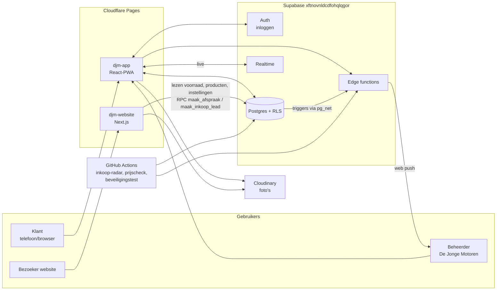
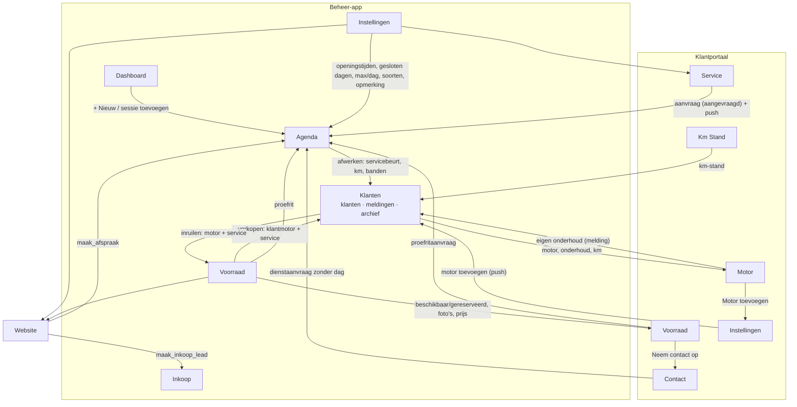

# De Jonge Motoren — architectuur van de app

Dit document beschrijft hoe de app in elkaar zit: onderdelen, tabbladen, datastromen, database,
achtergrondtaken en de koppeling met de website. Bedoeld voor een ontwikkelaar die de app overneemt
of uitbreidt. Stand: 6 november 2026.

---

## 1. Overzicht

Eén Supabase-database wordt gedeeld door drie "voorkanten" en een paar achtergrondtaken:



| Onderdeel | Repo / plek | Wat |
|---|---|---|
| **App** (dit repo) | `Mrjeffa/djm-app` → Cloudflare Pages | Klantportaal én beheer-app in één PWA. |
| **Website** | `Mrjeffa/djm-website` → Cloudflare Pages (`www.dejongemotoren.nl`) | Publieke site: occasions, werkplaats, formulieren. Zie §11. |
| **Database** | Supabase-project `xftnovnldcdfohqlqgor` (Free plan, regio eu-west-3) | Postgres met Row Level Security, Auth, Realtime, edge functions. |
| **Achtergrondtaken** | `.github/workflows/` + `inkoop-radar/` (Python) | Inkoop-radar (dagelijks), voorraad-prijscheck (wekelijks), beveiligingstest. |
| **Foto's** | Cloudinary (cloud `dkfdwnep4`, preset `Djm app`) | Upload vanuit de app, tonen met transformaties (`/upload/c_scale,w_…/`). |

## 2. Techniek

- **Frontend:** React 18, Vite 6, geen router (navigatie via state), inline styles met een
  thema-object `T` (licht/donker). Geen TypeScript in `src/` (wel in `supabase/functions/`).
- **Backend:** Supabase JS v2 met de publieke anon key (`src/lib/supabase.js`). Alle rechten
  worden in de database afgedwongen met RLS — de frontend is nooit de beveiliging.
- **Hosting:** Cloudflare Pages bouwt `main` (`npm run build` → `dist/`). `public/_redirects`
  stuurt alle routes naar `index.html`; `public/_headers` zet CSP, HSTS e.d. en caching.
- **PWA:** `public/manifest.webmanifest`, `public/sw.js`, iconen in `public/icons/`.

## 3. Mappenstructuur

```
djm-app/
├─ index.html                 # HTML-schil, fonts, manifest/iconen, theme-color
├─ public/
│  ├─ _headers                # Cloudflare: CSP, HSTS, caching (sw.js/manifest no-cache)
│  ├─ _redirects              # SPA: alles → index.html
│  ├─ manifest.webmanifest    # PWA-manifest
│  ├─ sw.js                   # service worker: cache eigen bestanden, pushmeldingen
│  ├─ icons/                  # app-iconen, badge, favicons
│  ├─ larsson_voertuigen.json # opzoektabel onderdelen (Larsson), lazy geladen
│  └─ autoscout-djm.user.js   # Tampermonkey-script dat het AutoScout-formulier invult
├─ src/
│  ├─ main.jsx                # React-start + import van lib/pwa.js
│  ├─ App.jsx                 # sessie, rol bepalen, lazy laden Admin/Klant, foutvangnet
│  ├─ components/
│  │  ├─ AdminApp.jsx         # beheer-app (alle pagina's en modals, ~5.800 regels)
│  │  ├─ KlantApp.jsx         # klantportaal (~2.700 regels)
│  │  ├─ LoginScreen.jsx      # inloggen, registreren, wachtwoord vergeten
│  │  ├─ WachtwoordInstellen.jsx # na reset-link
│  │  ├─ Juridisch.jsx        # privacybeleid, voorwaarden, cookiebanner
│  │  ├─ AppInstalleren.jsx   # kader "App installeren" (klantportaal)
│  │  └─ PushInstellingen.jsx # pushmeldingen aan/uit (admin)
│  └─ lib/
│     ├─ supabase.js          # Supabase-client + uitloggen/uitnodiging
│     ├─ foto.js              # foto's verkleinen + uploaden naar Cloudinary
│     ├─ kmstand.js           # km ↔ mijl (opslag altijd km)
│     ├─ getal.js             # Nederlandse bedragen/getallen parsen (naarBedrag)
│     ├─ pwa.js               # service worker registreren, installatievraag
│     ├─ push.js              # pushabonnement aan/uit, testmelding
│     ├─ larsson.js           # onderdelen-link zoeken (Larsson)
│     └─ autoscout.js         # gegevens klaarzetten voor AutoScout24
├─ supabase/
│  ├─ functions/              # edge functions (Deno): zie §9
│  ├─ *.sql                   # migraties/stand van zaken per onderwerp (zie §8.5)
│  └─ *-test.sql              # SQL-tests die alles terugdraaien (RLS, dagcapaciteit, website)
├─ inkoop-radar/              # Python: inkoop-radar, voorraad-prijscheck, diagnose, tests
├─ scripts/beveiligingstest.py # buitenstaander-test (draait in GitHub Actions)
├─ .github/workflows/         # build, beveiligingstest, inkoop-radar, voorraad-prijscheck
└─ docs/ARCHITECTUUR.md       # dit document
```

## 4. Opstart, inloggen en rollen

```
main.jsx → lib/pwa.js (service worker + installatievraag opvangen)
        → App.jsx
           ├─ #type=recovery in URL?  → WachtwoordInstellen
           ├─ geen sessie              → LoginScreen
           ├─ sessie + admin           → AdminApp   (lazy geladen chunk)
           └─ sessie + klant           → KlantApp   (lazy geladen chunk)
```

- **Sessie:** Supabase bewaart de sessie in `localStorage` (`persistSession`), ververst de
  token zelf. In de geïnstalleerde app op iOS is de opslag gescheiden van Safari: één keer
  inloggen in de app.
- **Rol:** `checkIsAdmin()` leest `admins` (RLS: alleen de eigen rij). Een hint wordt in
  `sessionStorage` (`djm_admin_v1`) bewaard zodat herladen geen laadscherm geeft. Die hint
  bepaalt alleen welk scherm je ziet; wat je mag lezen/schrijven bepaalt de database.
- **Klant koppelen** (`koppelKlant`, alleen voor niet-admins): zoekt een `klanten`-rij op e-mail;
  bestaat die zonder account, dan wordt `user_id` gezet; anders wordt er een aangemaakt.
  Bij registratie maakt de database-trigger `handle_new_auth_user` die rij meestal al aan,
  mét naam, telefoon, adres en woonplaats uit het aanmeldformulier. Het klantportaal zelf
  koppelt niet meer (dat gebeurde eerder dubbel).
- **Sessie-events:** `verwerkSessie` draait één keer per gebruiker. Een herhaalde `SIGNED_IN`
  (bv. bij terugkeren naar het tabblad) of `TOKEN_REFRESHED` laadt de app niet opnieuw; de
  admin-controle wordt hooguit elke 10 minuten herhaald.
- **Na een update:** lazy chunks die niet meer bestaan → één keer automatisch herladen
  (`laadMetHerstel` in `App.jsx`).
- **Foutvangnet:** een onverwachte React-fout toont een nette "Herlaad de app"-pagina.
- **Uitloggen** (`uitloggen()` in `lib/supabase.js`): meldt eerst de pushmeldingen van dit
  apparaat af (hooguit 3 s wachten), dan `signOut`. Zo krijgt een gedeeld apparaat geen
  beheerdersmeldingen meer.
- **Middernacht:** `TODAY` (module-variabele in AdminApp/KlantApp) wordt bijgewerkt als de app
  over middernacht open blijft (bij zichtbaar worden en elke 5 minuten).

## 5. Beheer-app (`AdminApp.jsx`)

Navigatie: state `page` (zijbalk op desktop, onderbalk op mobiel). Diepe link: `/?pagina=agenda`
(gebruikt door pushmeldingen; de service worker stuurt ook een `open-pagina`-bericht als de app
al open staat). Geldige pagina's staan in `ADMIN_PAGINAS`.

| Tabblad (`page`) | Component | Wat je er doet | Belangrijkste tabellen |
|---|---|---|---|
| `dashboard` | `Dashboard` | Overzicht van vandaag/deze week, openstaande aanvragen, klussen, taken | afspraken, klussen, taken |
| `klanten` | `KlantenPage` → `KlantDetail` | Klanten goedkeuren/afwijzen/archiveren, motoren, km, onderhoud, afspraak inplannen, uitnodigen | klanten, motoren, km_historie, service_beurten, afspraken |
| `voorraad` | `VoorraadPage` | Voorraadmotoren (foto's, km/mijl, interne opmerking, inkoopprijs, chassis), verkopen aan klant, terugkopen, proefrit, prijscheck, producten/onderdelen | voorraad (+ voorraad_intern/inkoop/chassis/prijscheck/service), producten |
| `agenda` | `AgendaPage` | Dag/week-agenda, afspraken plannen/wijzigen/afwerken/herhalen, klussen in fases, proefritten | afspraken (+ afspraken_intern), klussen, service_beurten |
| `inkoop` | `InkoopRadarPage` | Leads van 2dehands met inkoopadvies (Motoroccasion), populaire modellen | inkoop_leads, inkoop_radar_status, inkoop_populair |
| `instellingen` | `InstellingenPage` | Pushmeldingen, bericht aan klanten, openingstijden, afspraken per dag, gesloten periodes, tarieven, afspraaksoorten, medewerkers, kleurcategorieën, inkoop-radar, import/export (xlsx) | instellingen, push_abonnementen |

**Belangrijke modals:** `AfspraakModal` (nieuwe afspraak: bestaande klant / nieuwe klant / intern,
soorten, medewerkers, kleurcategorie, herhalen, klus-fases), `AfspraakEditModal`, `AfwerkModal`
(afwerken + onderhoud registreren + interne opmerking), `ProefritModal`, `VoorraadModal` /
`VoorraadEditModal`, `KlantModal`, `MotorModal`, `ServiceModal`, `ProductModal`, `UitnodigingModal`.

**Data laden** (`laadAlles` in de hoofdcomponent, één keer bij openen, alles in **één ronde**
tegelijk met `Promise.all`):
- klanten, voorraad (actief + 30 dagen na verkoop), afspraken (vanaf 12 maanden terug, met
  `AFSPRAAK_VELDEN` = klantnaam, motor en `afspraken_intern(opmerking)`), producten,
  voorraad_service, klussen, voorraad_chassis/inkoop/prijscheck/intern, inkoop_leads (500),
  radarstatus, populaire modellen, instellingen, en motoren + km_historie + service_beurten
  van alle klanten (incl. banddatums).
- Samengevoegd per klant/motor met `groepeer()` (Map) en `Map`-opzoekingen, niet met herhaald
  filteren. Servicehistorie in de beheer-app: nieuwste eerst.
- Tabellen die meegroeien worden per 1000 rijen opgehaald met `alleRijen()` (Supabase geeft
  max. 1000 rijen per verzoek).
- Opruimen op de achtergrond (`ruimVerlopenOp`): verlopen voorraad/producten 30 dagen na
  verkoop. In een paar verzoeken voor alle motoren samen: servicehistorie naar de klantmotor
  kopiëren, rijen verwijderen, en pas daarna de foto's via `cloudinary-delete`.
- Ophalen dat mislukt (bv. inkoop herladen zonder netwerk) laat de bestaande lijst staan.

**Live bijwerken (Realtime):** kanaal `admin-afspraken` (INSERT/UPDATE/DELETE op afspraken) en
`admin-klanten` (nieuwe/gewijzigde klanten). Realtime past RLS toe. Wat de app zelf net heeft
opgeslagen en ook via realtime binnenkomt, wordt op `id` ontdubbeld (afspraken, herhalingen,
nieuwe klant). Kanalen worden bij sluiten met `removeChannel` opgeruimd.

**Verkoop, inruil en terugkopen** (pagina Voorraad / klantdetail):
- *Verkopen aan klant* (`verkoop`): voorraad → `verkocht` (+ `verkocht_aan`, foto's 30 dagen
  bewaard), nieuwe klantmotor met `source_voorraad_id`, servicehistorie gekopieerd naar
  `service_beurten`. Mislukt de eerste stap, dan verandert er niets.
- *Inruilen* (`inruilMotorVanKlant`): nieuwe voorraadmotor (hoogste km-stand, `km_eenheid` km),
  servicehistorie naar `voorraad_service` (`kopieerServiceNaarVoorraad`), pas dan de klantmotor
  verwijderen. Mislukt de voorraadmotor of het kopiëren, dan blijft de klantmotor staan.
- *Terugkopen* (`terugkopenMotor`): zoekt de klantmotor via `source_voorraad_id` (niet op
  kenteken), kopieert de service uit de klanttijd terug naar `voorraad_service`, zet de
  voorraad weer op beschikbaar en verwijdert de klantmotor.

**Foutafhandeling:** opslaan in de beheer-app controleert de `error` van Supabase en toont een
melding (klant toevoegen, uitnodigen, voorraad toevoegen/wijzigen, verkoop, afwerken,
instellingen, gesloten dagen). Een mislukte voorraadwijziging gooit geen foto's weg; net
geüploade foto's van een mislukte opslag worden opgeruimd.

**Gevoelige gegevens staan apart** (omdat `voorraad` en `afspraken` voor anderen leesbaar zijn):
`voorraad_inkoop` (inkoopprijs), `voorraad_chassis`, `voorraad_intern` (interne opmerking),
`afspraken_intern` (interne opmerking bij afspraak). Alleen admin (RLS).

## 5a. Hoe de tabbladen samenhangen

Tabbladen praten niet rechtstreeks met elkaar: ze delen de **database**. Wat het ene tabblad
opslaat, verschijnt in het andere (en in het klantportaal en op de website) via dezelfde
tabellen. Doorlinks binnen de app zijn er maar een paar.



| Van | Naar | Via | Hoe |
|---|---|---|---|
| Dashboard | Agenda | `onNav("agenda")` | knop "+ Nieuw" en "sessie toevoegen" bij een klus |
| Klanten → Meldingen/Archief | Klantdetail | `setSel(id)` + `setPageTab("klanten")` | tik op een melding of gearchiveerde klant |
| Pushmelding | elke pagina | `/?pagina=…` of `open-pagina`-bericht van de service worker | `ADMIN_PAGINAS` |
| Portaal Voorraad | Portaal Contact | `onNaarContact` | "Neem contact op" bij een motor/product |
| Portaal Motor | Portaal Instellingen | `onNaarInstellingen` | "Motor toevoegen" (opent het formulier) |
| Agenda (afwerken) | Klanten / portaal Motor | `service_beurten`, `km_historie`, `motoren` | servicebeurt + km + banden bij de klantmotor |
| Voorraad (verkopen) | Klanten / portaal Motor | `motoren` (`source_voorraad_id`), `service_beurten` | klant krijgt de motor met servicehistorie |
| Portaal Service/Contact/Voorraad | Agenda + Dashboard | `afspraken` (`status = aangevraagd`) | realtime + pushmelding |
| Instellingen | Agenda, portaal, website | `instellingen` (één rij) | openingstijden, gesloten dagen, max per dag, soorten, tarieven, opmerking |

## 6. Klantportaal (`KlantApp.jsx`)

Navigatie: state `tab` (onderbalk; instellingen via het tandwiel).

| Tab | Component | Wat de klant doet | Tabellen / functies |
|---|---|---|---|
| `motor` | `MijnMotor` | Eigen motor(en), onderhoudsstatus, servicegeschiedenis | motoren, service_beurten, km_historie |
| `service` | `ServiceTab` → `Afspraak` | Afspraak aanvragen (dagkeuze met volle dagen), eigen onderhoud invoeren, eigen afspraken zien | afspraken, service_beurten, rpc `get_bezette_dagen` |
| `km` | `KmStand` | Km-stand doorgeven | km_historie |
| `voorraad` | `VoorraadTab` | Occasions en onderdelen bekijken, proefrit aanvragen | voorraad (beschikbaar + 30 dagen verkocht), producten, afspraken |
| `contact` | `Contact` | Diensten aanvragen: schade, consignatie, aankoopkeuring, zoekopdracht, winterstalling, seizoensklaarmaak (met foto's) | afspraken (`dag_gekozen=false` zonder datum) |
| `instellingen` | `Instellingen` | App installeren, gegevens, wachtwoord, motoren toevoegen/verwijderen, thema, gegevens downloaden, account verwijderen | klanten, motoren, rpc `verwijder_eigen_account` |

**Toegang per status** (`klanten.status`): alleen `goedgekeurd` komt in het portaal.
`in_afwachting` → "Account wordt beoordeeld", `afgewezen` → "niet goedgekeurd",
`gearchiveerd` of iets anders → "Account niet actief". Geen klantrecord → "Wacht op
goedkeuring". Lukt het laden niet (netwerk) → "Laden mislukt" met knop "Opnieuw proberen"
(voorheen leek dat op "wacht op goedkeuring").

**Data laden** (drie rondes, binnen een ronde alles tegelijk):
1. klantrecord (`user_id`, `maybeSingle`), volle dagen (rpc), instellingen, voorraad, producten;
2. alleen als goedgekeurd: eigen afspraken + motoren (zonder `klant_verwijderd_op`);
3. km_historie + service_beurten van die motoren (oplopend; schermen nemen het laatste element
   als "laatste service"). De huidige km-stand is de **hoogste** stand (`hoogsteKm`).

Volle dagen worden bij het wisselen naar service/contact/voorraad hooguit eens per minuut
opnieuw opgehaald, en altijd na een eigen aanvraag of een "dag vol"-weigering. Live: kanaal
`klant-afspraken-<klant-id>` (UPDATE/INSERT gefilterd op `klant_id`; DELETE alleen op id).
`localStorage`/`sessionStorage` gaan via `leesOpslag`/`schrijfOpslag` (werkt ook als opslag
geblokkeerd is, zoals in een privévenster).

**Regels die de database bewaakt** (de app toont ze alleen):
- Een klant ziet/wijzigt alleen eigen gegevens; status, e-mail en koppeling kan alleen de
  beheerder wijzigen (trigger `bewaak_klanten_mutaties`).
- Nieuwe afspraak van een klant krijgt altijd status `aangevraagd`; daarna mag de klant alleen
  `melding_gezien` wijzigen (trigger `bewaak_afspraken_mutaties`).
- Max. afspraken per dag (trigger `afspraken_dagcapaciteit`, zie §8.3).
- Motor verwijderen: zonder garage-historie echt weg, anders alleen verborgen
  (`motoren.klant_verwijderd_op`, policy `klant_motoren_verwijderen`).

## 7. PWA en pushmeldingen

- **Service worker** (`public/sw.js`, cache `djm-v2`): cachet alleen eigen bestanden.
  Navigatie network-first met offline-fallback (alleen een echte HTML-pagina wordt als `/`
  bewaard); `/assets/*` cache-first (hash in de naam); `/icons/*` uit de cache en op de
  achtergrond ververst. Supabase/Cloudinary/RDW nooit. Toont pushmeldingen en opent bij een
  tik de juiste pagina.
- **Installeren:** `lib/pwa.js` vangt `beforeinstallprompt` op; `AppInstalleren.jsx` toont de
  knop (Android) of de iPhone-uitleg.
- **Push (alleen beheerder):** `PushInstellingen.jsx` → `lib/push.js` meldt het apparaat aan
  (`push_abonnementen`; lukt het opslaan niet, dan wordt de browser-aanmelding teruggedraaid). De database stuurt bij gebeurtenissen via `pg_net` een verzoek naar de
  edge function `push-melding`, die de melding opbouwt uit de database en verstuurt.
  Gebeurtenissen: nieuwe afspraak/aanvraag (status `aangevraagd`), inkoop-aanvraag, inkoop-radar
  (één per run), nieuwe klant (na e-mailbevestiging), klant voegt motor/onderhoud toe, klant
  verwijdert account. Eigen acties van de beheerder geven geen melding. Op iPhone alleen in de
  geïnstalleerde app (iOS 16.4+).

## 8. Database

### 8.1 Tabellen

| Tabel | Inhoud | Wie mag wat (RLS) |
|---|---|---|
| `admins` | beheerders (user-id) | eigen rij lezen |
| `klanten` | klantgegevens, `user_id` (koppeling account), `status` | klant: eigen rij lezen/wijzigen; admin: alles |
| `motoren` | motoren van klanten (`klant_verwijderd_op` = verborgen voor klant; `source_voorraad_id` = gekocht uit voorraad; `onderdelen_link` alleen http(s), constraint) | klant: eigen lezen/toevoegen/wijzigen, verwijderen zonder garage-historie; admin: alles |
| `km_historie` | km-standen per motor | klant: eigen; admin: alles |
| `service_beurten` | onderhoud (`klant_invoer` = door klant ingevoerd) | klant: lezen eigen, eigen invoer toevoegen/wijzigen; admin: alles |
| `afspraken` | afspraken en aanvragen (`status`, `dag_gekozen`, `type`, `soort`, `medewerker_namen`, `categorie`, klus-velden) | klant: eigen lezen/aanvragen; admin: alles; website: alleen via `maak_afspraak` |
| `afspraken_intern` | interne opmerking bij een afspraak | alleen admin |
| `voorraad` | voorraadmotoren (`km` altijd km, `km_eenheid` km/mijl, foto's, status) | iedereen: beschikbaar/gereserveerd; ingelogd: ook 30 dagen na verkoop; admin: alles |
| `voorraad_inkoop` / `voorraad_chassis` / `voorraad_intern` / `voorraad_prijscheck` / `voorraad_service` | inkoopprijs, chassisnr., interne opmerking, Motoroccasion-check, onderhoud vóór verkoop | alleen admin |
| `producten` | onderdelen/accessoires te koop | iedereen: actief en niet verkocht; admin: alles |
| `klussen` | meerdaagse klussen met fases | alleen admin |
| `taken` | takenlijst beheerder | alleen admin (eigen) |
| `instellingen` | één rij (`id=1`): openingstijden, gesloten dagen, tarieven, soorten, medewerkers, kleurcategorieën, `max_afspraken_per_dag`, `website_content`, `inkoop_bewaar_dagen` | iedereen lezen; admin wijzigen |
| `inkoop_leads` / `inkoop_radar_status` / `inkoop_populair` / `inkoop_aanvragen` | inkoop-radar en inkoopaanvragen van de website | alleen admin (+ service role) |
| `push_abonnementen` | pushapparaten van admins | admin: eigen |
| `push_log` / `push_sleutels` | verstuurde meldingen, VAPID-sleutels | alleen server (service role) |

### 8.2 Functies (RPC) — aan te roepen via de API

| Functie | Voor wie | Wat |
|---|---|---|
| `is_admin()` | iedereen (nodig voor RLS) | is de aanroeper beheerder? |
| `maak_afspraak(...)` | website (anoniem) | afspraak/proefrit aanvragen met controles (invoer, 3 per telefoon per 24 u, open dag, dagcapaciteit). Geen datum of vandaag = aanvraag zonder dag. Weigering = fout (RAISE). |
| `maak_inkoop_lead(...)` | website (anoniem) | "wij kopen je motor"-aanvraag → `inkoop_aanvragen` |
| `get_drukke_datums(start, eind)` | website (anoniem) | aantal meetellende afspraken per dag (alleen datums + aantallen) |
| `get_bezette_dagen()` | ingelogd (klantportaal) | volle dagen (≥ `max_afspraken_per_dag`) |
| `verwijder_eigen_account()` | klant | account opheffen (klantrecord gearchiveerd, login verwijderd) |
| `delete_auth_user_by_id(id)` | admin | login van een klant verwijderen |

Functies in schema `private` (niet via de API bereikbaar): `meld_push` (pushtrigger),
`telt_voor_dagcapaciteit`, `max_afspraken_per_dag`, `bewaak_dagcapaciteit`,
`verplaats_interne_opmerking`, `motor_heeft_garagehistorie`.

### 8.3 Regels en triggers

| Trigger | Tabel | Wat |
|---|---|---|
| `on_auth_user_created` | auth.users | `handle_new_auth_user`: klantrecord aanmaken/koppelen bij registratie, met naam/telefoon/adres/woonplaats uit het formulier; een gearchiveerd record gaat terug naar `in_afwachting` |
| `klanten_bewaak` | klanten | klant mag status/e-mail/koppeling niet zelf wijzigen |
| `afspraken_bewaak` | afspraken | klant: nieuwe aanvraag = `aangevraagd`; daarna alleen `melding_gezien` |
| `afspraken_dagcapaciteit` | afspraken | klant/website: geen afspraak op een volle dag (advisory lock tegen gelijktijdig boeken) |
| `afspraken_interne_opmerking_apart` | afspraken | vangnet: oude kolom `interne_opmerking` → `afspraken_intern` |
| `push_*` (8 stuks) | afspraken, inkoop_aanvragen, inkoop_radar_status, motoren, service_beurten, klanten, auth.users | pushmelding klaarzetten (pg_net → `push-melding`) |

**Dagcapaciteit:** een dag is vol bij `instellingen.max_afspraken_per_dag` (nu 1) afspraken die
meetellen: niet geannuleerd, en niet een aanvraag zonder gekozen dag (`dag_gekozen = false`)
die nog niet is ingepland. De beheerder mag altijd inplannen.

### 8.4 Realtime

Publicatie `supabase_realtime`: `afspraken`, `klanten`.

### 8.5 Migraties en SQL-bestanden

Wijzigingen worden als migratie toegepast (Supabase → migraties) en per onderwerp bewaard in
`supabase/*.sql`: `beveiliging.sql`, `rls.sql`, `push.sql`, `voorraad_velden.sql`,
`afspraken_intern_en_motoren.sql`, `dagcapaciteit.sql`, `website_koppeling.sql`,
`links_en_registratie.sql` (onderdelen-links alleen http(s), registratiegegevens), plus
`supabase/functions/voorraad-prijscheck/schema.sql` en `inkoop-radar/schema.sql`. Ze zijn
herhaalbaar. Tests (draaien in de SQL Editor, draaien alles terug): `rls-test.sql`,
`dagcapaciteit-test.sql`, `website-test.sql`.

## 9. Edge functions (`supabase/functions/`)

| Functie | Aangeroepen door | Toegang | Wat |
|---|---|---|---|
| `cloudinary-delete` | beheer-app | alleen admin, alleen eigen Cloudinary-URL's | foto's verwijderen |
| `voorraad-prijscheck` | beheer-app ("Check prijs"), wekelijkse job | admin of service role | voorraad vergelijken met Motoroccasion (logica in `logica.ts`, gedeeld met de app) |
| `push-melding` | database-triggers (pg_net), beheer-app (sleutel/test) | trigger-aanroepen worden zelf in de database geverifieerd; sleutel/test alleen admin | web push versturen (VAPID/aes128gcm via WebCrypto, `webpush.ts`) |
| `cloudinary-sign` | (nog) niets in deze app | alleen admin | handtekening voor ondertekende uploads; staat live maar wordt niet gebruikt. De code staat niet in `main` maar op de oude branch `claude/agent-skills-context-engineering-dgakz3` (eigen geschiedenis). Opruimen of afmaken. |

Let op: `verify_jwt` alleen is niet genoeg — de publieke anon key is ook een geldige JWT. Elke
functie controleert zelf `is_admin()` waar nodig.

## 10. Achtergrondtaken (GitHub Actions)

| Workflow | Wanneer | Wat |
|---|---|---|
| `build.yml` | elke push naar main en elke PR | `npm ci && npm run build` |
| `beveiligingstest.yml` | elke push + maandag 05:17 UTC | `scripts/beveiligingstest.py`: probeert als buitenstaander bij afgeschermde tabellen/functies te komen |
| `inkoop-radar.yml` | dagelijks 05:00 UTC + handmatig (modi normaal / alleen-prijzen / diagnose / diagnose-voorraad) | `inkoop-radar/fetch_leads.py`: 2dehands-advertenties ophalen, inkoopadvies via Motoroccasion, leads opschonen, digest-mail (Resend) |
| `voorraad-prijscheck.yml` | maandag 06:00 UTC | `inkoop-radar/voorraad_check.py`: alle voorraad laten checken via de edge function, mail bij actie |

Secrets (GitHub → Settings → Secrets): `SUPABASE_URL`, `SUPABASE_SERVICE_ROLE_KEY`, `RESEND_API_KEY`,
`DIGEST_FROM`, `DIGEST_TO`. Zie `inkoop-radar/README.md`.

## 11. Koppeling met de website (`Mrjeffa/djm-website`)

De website is een Next.js 15-site (App Router, edge-rendering via `@cloudflare/next-on-pages`)
op Cloudflare Pages (`https://www.dejongemotoren.nl`). Hij gebruikt dezelfde database met de
**publieke** sleutel (`NEXT_PUBLIC_SUPABASE_URL`, `NEXT_PUBLIC_SUPABASE_PUBLISHABLE_KEY`) en
heeft geen service-role key. Elke pagina wordt per verzoek opgebouwd (geen ISR/cache).

| Website | Database | Richting |
|---|---|---|
| Alle pagina's (`layout.tsx` → `getInstellingen.ts`) | `instellingen` (openingstijden, gesloten dagen/weken, `max_afspraken_per_dag`, opmerking, tarieven, soorten, `website_content`) | lezen |
| Occasions, occasion-detail, home, proefrit, sitemap, llms.txt (`lib/motors.ts`) | `voorraad` (status beschikbaar/gereserveerd; o.a. merk, model, bouwjaar, km, `km_eenheid`, prijs, foto's) | lezen |
| Onderdelen, sitemap (`lib/producten.ts`) | `producten` (actief, niet verkocht) | lezen |
| Proefrit- en werkplaatsformulier (`forms/shared.tsx`) | rpc `get_drukke_datums` (vandaag + 120 dagen) | lezen in de browser |
| Proefritformulier (`ProefritForm.tsx`) | rpc `maak_afspraak` (type `proefrit`) | schrijven |
| Werkplaats-/winterstallingformulier (`WerkplaatsForm.tsx`) | rpc `maak_afspraak` (type `service`) | schrijven |
| Inkoopformulier (`InkoopForm.tsx`, home + `/motor-verkopen`) | rpc `maak_inkoop_lead` | schrijven |
| Foto's (`lib/cloudinary.ts`) | URL's uit `voorraad.fotos` / `producten.fotos` | alleen tonen |

Wat de beheerder in de app doet, verschijnt dus direct op de website: voorraad op
"beschikbaar" zetten, foto's, prijs, producten, openingstijden en gesloten dagen
(Instellingen), en `website_content`. Aanvragen van de website komen in de app binnen als
afspraak met status `aangevraagd` (agenda/dashboard, pushmelding) of als inkoop-aanvraag.

De website linkt niet naar de app (de app wordt alleen in tekst genoemd).

**Bekende punten in de website-code** (repo djm-website, nog niet aangepast):
- Formulieren kijken alleen naar `error`. Sinds november 2026 geeft `maak_afspraak` bij een
  weigering een echte fout, zodat de site "Versturen lukte niet" toont i.p.v. "Bedankt"; de
  precieze reden (`error.message`) wordt nog niet getoond.
- Zonder gekozen datum stuurt de site vandaag mee; de database behandelt dat als aanvraag
  zonder dag. Netter: `p_datum: null` sturen.
- `formatKm` (`lib/motors.ts`) toont het km-getal met "mijl" erachter zonder om te rekenen;
  gebruik km ÷ 1,609344 (zoals `src/lib/kmstand.js` in de app).
- Valt terug op 5 afspraken per dag als `instellingen` niet laadt (database: 1).
- Leesfouten bij voorraad/producten worden niet getoond ("alles verkocht").
- `public/_headers` heeft geen CSP/HSTS.

## 12. Externe diensten

| Dienst | Waar | Wat |
|---|---|---|
| Supabase | overal | database, inloggen, realtime, edge functions |
| Cloudinary | `lib/foto.js`, `cloudinary-delete` | foto-opslag (unsigned preset `Djm app`) |
| RDW open data (`opendata.rdw.nl`) | voorraad/klant-motor toevoegen | merk/model/bouwjaar op kenteken |
| Motoroccasion.nl | inkoop-radar, `voorraad-prijscheck` | marktprijzen (één verzoek per motor, robots.txt gerespecteerd) |
| 2dehands.be | inkoop-radar | nieuwe advertenties |
| Larsson (`mike2.larsson.nl`) | `lib/larsson.js` | onderdelen bestellen (link) |
| AutoScout24 | `lib/autoscout.js` + userscript | advertentie klaarzetten |
| Resend | inkoop-radar | digest-mail |
| Web push (Google/Apple/Mozilla) | `push-melding` | meldingen naar admin-apparaten |
| Google Calendar, WhatsApp | links | afspraak in agenda zetten, delen |

## 13. Beveiliging in het kort

- RLS op alle tabellen; gevoelige velden in aparte admin-tabellen; triggers bewaken wat klanten
  mogen wijzigen.
- Publieke formulieren alleen via `SECURITY DEFINER`-functies met invoercontroles en limieten.
- Edge functions controleren zelf of de aanroeper admin is.
- Links die van buiten komen (onderdelen-link van een klant, advertentie-URL's uit de
  inkoop-radar) gaan in de app door `veiligeUrl()` (`lib/larsson.js`): alleen http(s), zodat een
  `javascript:`-link niet in de beheer-app kan draaien. De database dwingt dat ook af voor
  `onderdelen_link` (constraints `*_onderdelen_link_http`).
- Recent verkochte voorraad (kenteken, koper) alleen voor ingelogde gebruikers.
- `public/_headers`: CSP (alleen eigen scripts; verbindingen naar Supabase, Cloudinary, RDW),
  HSTS, nosniff, geen framing, referrer-policy, permissions-policy.
- Controle: `scripts/beveiligingstest.py` (GitHub Actions), `supabase/rls-test.sql`,
  Supabase → Advisors.
- Nog in Supabase in te stellen: lek-wachtwoordcontrole (Pro-plan), eigen SMTP, wachtwoordeisen.

## 14. Ontwikkelen

```bash
npm install
npm run dev        # lokaal (geen service worker in dev)
npm run build      # productie-build in dist/
# logica-tests voorraad-prijscheck:
npx esbuild supabase/functions/voorraad-prijscheck/logica.test.ts --bundle --platform=node --format=esm --outfile=/tmp/t.mjs && node /tmp/t.mjs
# inkoop-radar tests:
cd inkoop-radar && python test_prijzen.py && python test_motoroccasion.py && python test_mapping.py
# database-tests: plak supabase/rls-test.sql, dagcapaciteit-test.sql of website-test.sql in de
# SQL Editor; ze draaien alles terug en melden de uitkomst in de foutmelding
```

Afspraken in de code:
- Namen en teksten in het Nederlands.
- Datums als lokale datum (`lokaleDatum()`), niet `toISOString()` — die is UTC en geeft rond
  middernacht de verkeerde dag. Rekenen met datums via `lokaleDag()` / `plusDagen()`
  (AdminApp), niet `new Date("JJJJ-MM-DD")`: dat is UTC-middernacht en schoof rond de overgang
  zomer-/wintertijd een week of periode een dag op.
- Supabase gooit geen fout maar geeft `{ data, error }` terug: altijd `error` controleren en de
  gebruiker een melding geven; pas daarna de schermstatus bijwerken.
- Meerdere onafhankelijke verzoeken tegelijk (`Promise.all`), niet na elkaar.
- `voorraad.km` altijd in kilometers; `km_eenheid` alleen voor weergave.
- Bedragen/getallen van invoer altijd via `naarBedrag()` (`lib/getal.js`).
- Nieuwe externe dienst in de app → domein toevoegen aan `connect-src` in `public/_headers`.
- Nieuwe tabel → RLS aanzetten, policies schrijven, toevoegen aan `scripts/beveiligingstest.py`
  (als hij afgeschermd moet zijn) en aan dit document.
- Wijzigingen via een PR naar `main`; Cloudflare Pages zet `main` live.
